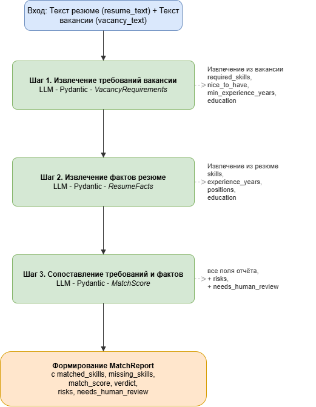

# resume-vacancy-matcher

Система сопоставляет резюме кандидата с требованиями вакансии и выдаёт структурированный отчёт о соответствии для рекрутёра.

## Вход

- `resume_text: str` — текст резюме
- `vacancy_text: str` — текст вакансии

## Выход (`MatchReport`)

- `matched_skills` — навыки, которые есть в резюме и требуются в вакансии
- `missing_skills` — требуемые навыки, которых нет в резюме
- `match_score` — оценка совпадения (0–100)
- `verdict` — степень соответствия: `strong_match` / `partial_match` / `weak_match`
- `risks` — риски и неоднозначности в резюме, на которые следует обратить внимание рекрутёру
- `needs_human_review` — флаг ручной проверки, требуется ли проверка человеком

## Операции

1. Извлечение требований из вакансии (навыки, опыт, образование).
2. Извлечение фактов из резюме (навыки, опыт, образование).
3. Сопоставление требований из вакансии и фактов из резюме.

## Схема архитектуры



## Описание архитектуры — Sequential

Система реализована как последовательный workflow из трёх LLM-шагов. Каждый шаг решает одну узкую задачу и возвращает результат в виде Pydantic-модели, которая передаётся следующему шагу.

**Шаг 1 — извлечение требований вакансии.** Модель получает текст вакансии и извлекает структурированные данные: название позиции, обязательные и желательные навыки, минимальный опыт и требования к образованию. Результат валидируется моделью `VacancyRequirements`.

**Шаг 2 — извлечение фактов резюме.** Модель получает текст резюме и извлекает навыки, опыт, занимаемые должности и образование. Результат валидируется моделью `ResumeFacts`.

**Шаг 3 — сопоставление.** Модель получает исходные тексты вместе с результатами первых двух шагов и формирует итоговый отчёт: списки совпавших и недостающих навыков, интегральную оценку `match_score`, вердикт `verdict`, список рисков и флаг `needs_human_review`. Результат валидируется моделью `MatchScore` и является итоговым объектом `MatchReport`.

## Инструкция по запуску

1. Создать файл .env, добавить переменные окружения:

```
GIGACHAT_CREDENTIALS=<Авторизационный ключ из Cбер Studio>
GIGACHAT_SCOPE=GIGACHAT_API_PERS
GIGACHAT_MODEL=GigaChat-2
```

Подробнее о получении авторизационного ключа - https://developers.sber.ru/docs/ru/gigachat/quickstart/ind-using-api#poluchenie-avtorizatsionnyh-dannyh

2. Создание виртуального окружения

```
python -m venv .venv
.venv\Scripts\activat
```


3. Установка зависимостей
```
python -m pip install -r requirements.txt
```

3. Запуск CLI
```
set PYTHONPATH=src
python -m rvmatcher.cli
```

## ПРИМЕЧАНИЕ

Первое задание было выполнено в Google Colab на основе OpenRouter. Модели работали нестабильно, также быстро заканчивались токены. Поэтому, начиная со второго задания, был создан Python-проект на основе GigaChat.

Подробнее про первое задание в файле - 01_workflow_comparison.ipynb
